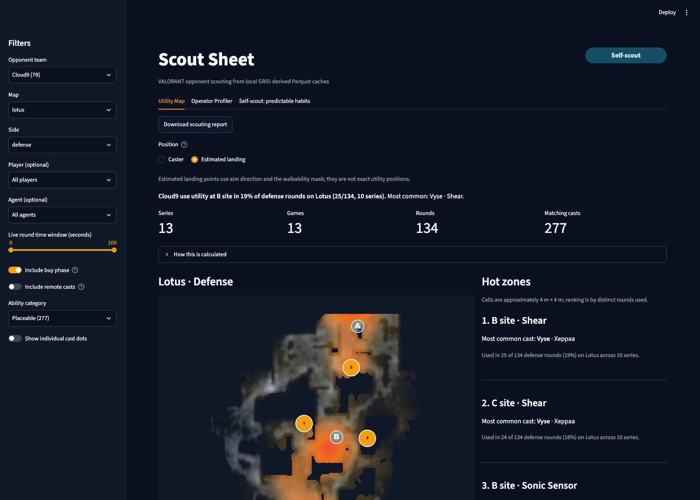
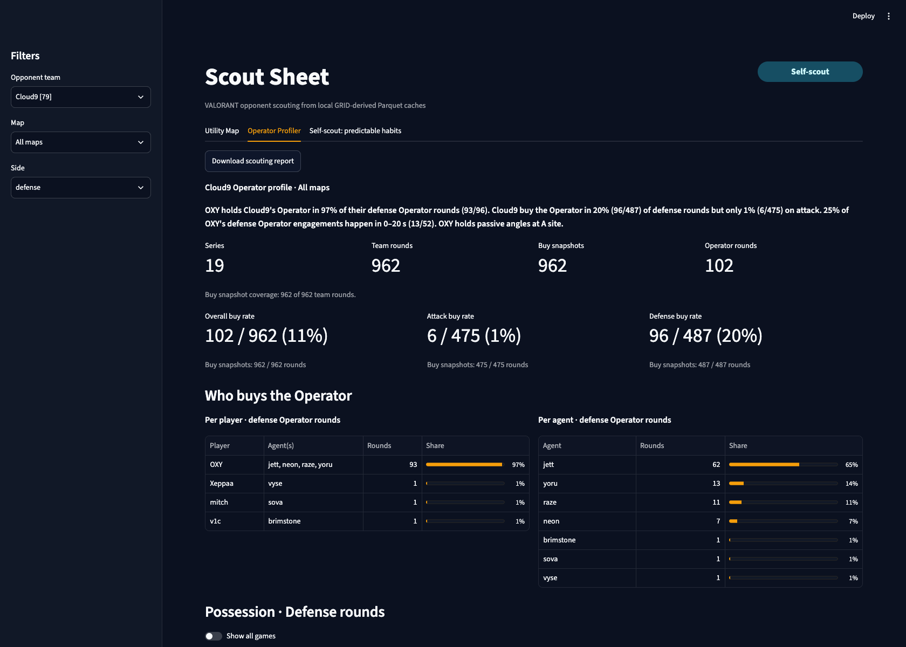
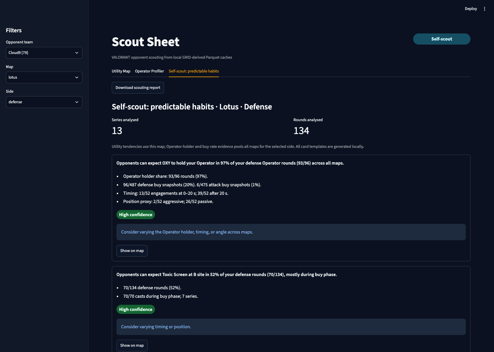
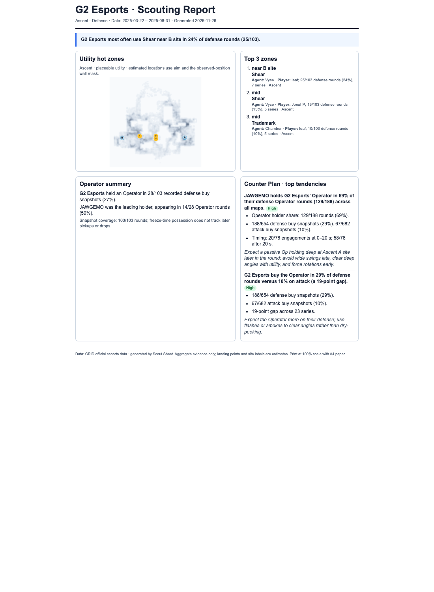

# Scout Sheet

Scout Sheet is a VALORANT opponent-scouting tool for coaches, built for the Cloud9 x JetBrains Sky's The Limit 2026 hackathon.

## Features

- **Utility Map:** explore placeable utility hot zones, round-based evidence, sites, and estimated landing positions.
- **Operator Profiler:** review buy rates, holders, handoffs, engagements, timing, and approximate aggression.
- **Counter Plan:** browse evidence-backed, rule-generated tendencies and suggested responses.
- **Printable report:** download a self-contained, A4-formatted HTML report with aggregate-only evidence and an embedded static map image from any tab.

## How it works

- `build_cache.py` streams the local GRID feeds and writes derived Parquet tables only to the git-ignored `cache/` directory. The default selection includes Cloud9 and Cloud9 GC series plus opponents' series from the same events; use `--limit 3` for a small smoke build or `--series-ids ID ...` for explicit series. `--all` incrementally processes all 857 VALORANT series with multiple workers, resumable per-series Parquet shards, progress/ETA, and a bounded-memory merge.
- The app reads those cached tables only. It never needs to copy GRID data into this repository; keep the starter repository beside Scout Sheet or set `STL_DATA_DIR` to its path.
- Utility percentages use distinct team/map/side rounds as the denominator. Adjacent 4 m cells within 6 m are merged when ability and site label match, then rounds are unioned before ranking. Cast filters do not silently change that denominator. Map silhouettes use observed positions, not Riot map artwork; site names and aim-based landing estimates are approximate, not verified geometry or exact projectile simulations.
- The report contains rendered aggregates and a generated chart, not raw event envelopes. Its map is one map at a time; when the map filter is `All maps`, spatial utility uses the team's most-played map and identifies it in the report.

## Run it yourself

1. Install `uv` (macOS/Linux):

   ```sh
   curl -LsSf https://astral.sh/uv/install.sh | sh
   ```

2. Clone Scout Sheet and the GRID starter into sibling directories:

   ```sh
   git clone https://github.com/jagadish2606/scout-sheet.git scout-sheet
   cd scout-sheet
   git clone https://github.com/cloud9esports/stl-hackathon-2026-grid-starter.git ../stl-hackathon-2026-grid-starter
   ```

   If your GRID starter checkout is elsewhere, set `STL_DATA_DIR` to its directory before building or launching.

3. Install project dependencies and download Chrome for Kaleido's static PNG export:

   ```sh
   uv sync
   uv run plotly_get_chrome -y
   ```

4. Build the local cache:

   ```sh
   uv run python build_cache.py
   ```

   The default selection covers about 97 Cloud9 and opponent series. To cover every VALORANT team, first benchmark 20 not-yet-cached series and review the reported estimate:

   ```sh
   uv run python build_cache.py --all --limit 20
   ```

   After reviewing the time and disk estimate, build all remaining series with `uv run python build_cache.py --all`; completed series are skipped on subsequent runs. Use `--workers 4` to set the parallel worker count. Builds stream local GRID feeds; no feed data is copied into the project.

5. Launch Scout Sheet:

   ```sh
   uv run streamlit run app.py
   ```

   Open `http://localhost:8501`. If the source data folder, tables, or global map artifacts are missing, the app displays this setup guide rather than failing with a traceback. Choose a circuit and then a team; team labels show cached series counts without exposing GRID IDs. Team lists are ordered by series count, and the initial selection is VCT Americas → Cloud9. Changing teams resets a map with fewer than 20 team rounds to that team's most-played map.

The cache includes `rounds.parquet`, `casts.parquet`, `kills.parquet`, `damage.parquet`, `buys.parquet`, `spawn_positions.parquet`, and `plants.parquet`. Feeds are streamed, invalid sessions and rolled-back games are excluded, and all derived tables and map artifacts stay in ignored `cache/`. Cast, kill, and damage timing is relative to `round-ended-freezetime`, so negative times represent buy phase; missing or generic player names are enriched only when `meta/players.csv` provides a more informative name.

The Utility Map's placeable category includes Cypher Trapwire/Spycam, Killjoy Alarmbot/Turret/Nanoswarm, Chamber Trademark, Vyse Arc Rose/Shear, and Deadlock Sonic Sensor. Nanoswarm is treated as a short placement because the feed does not identify long-throw casts; short placements use a 5 m estimate and Trapwire an 8 m estimate. Thrown abilities use pitch-scaled editable limits. Landing arrows appear only for the selected hot zone or a deterministic sample of at most 80 casts; the heat layer is clipped to the observed walkable mask.

The Operator Profiler reports freeze-end buy-snapshot coverage, Operator-round shares and handoffs, plus defense kill/damage encounters by the freeze-time holder. Select a single map for the engagement chart; `All maps` provides aggregate timing evidence without mixing coordinates. The possession strip shows the 15 most recent games first (expand to show all), with date, opponent, map and game number. Timing and angle claims require at least 10 player engagements. Possession does not track later pickups or drops. Aggressiveness uses the full-cache `cache/spawn_estimates.json` median freeze-end anchors when a map is present, and falls back to the selected team's proxy only for maps without a saved estimate.

Game Changers circuits recognize GRID event abbreviations (`NA`, `BR`, `LATAM`, `EMEA`, `JPN`, `KR`, `SEA`, and Pacific/Oceania) and group them into the regional choices in the sidebar. Summit currently has no verified plant-derived site centres, so site letters are hidden there rather than guessed.

Counter Plan creates local rule-based tendency cards from the same cached analyses. Utility cards stay scoped to the selected map; Operator-holder, buy-rate, timing and position evidence is aggregated across maps for the selected side. Confidence is High at 40+ rounds and 50%+ prevalence, Medium at 20+ rounds and 35%+ prevalence; the Watch list shows Low-confidence tendencies at 25% to under 35% with at least 20 rounds. No external AI service is used. Cloud9 and Cloud9 GC see self-scout wording and recommendations from their own point of view.

### Screenshots







